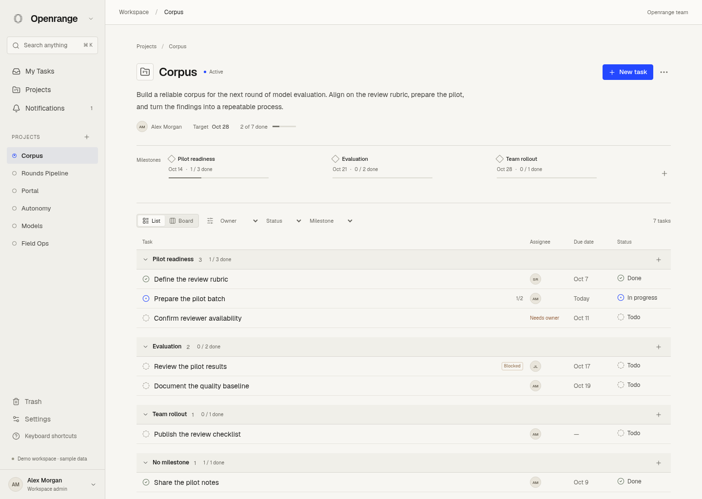
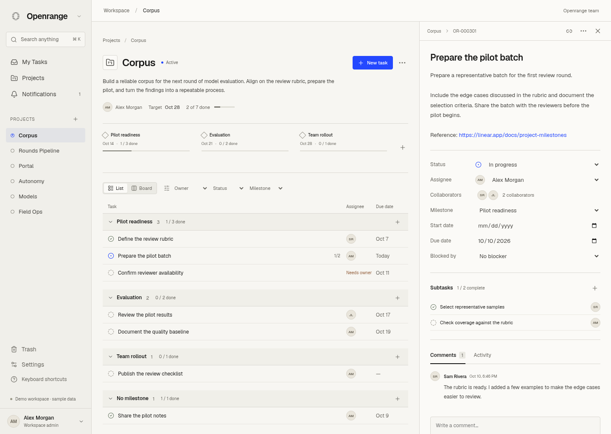
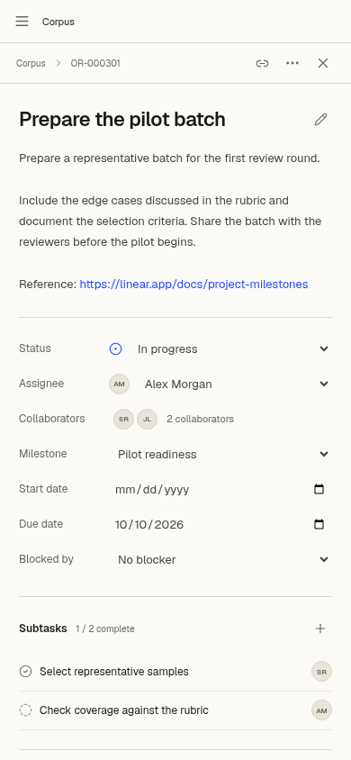

# Interface preview

These screenshots show fictional development data. Production migrations create no sample work. The desktop view is 1440 px wide; the mobile task view is 390 px wide.

## Project list and milestones

## Desktop task detail

## Mobile task detail

